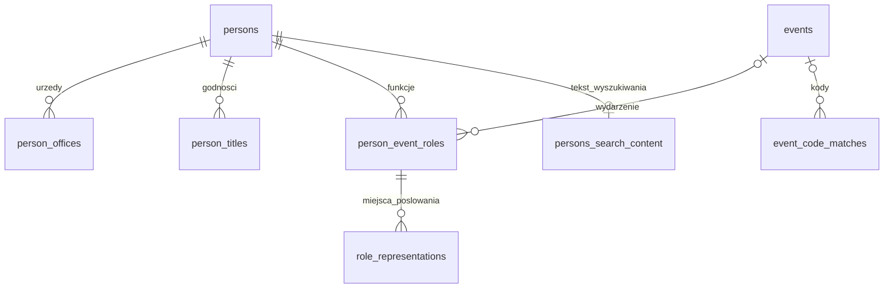

# Struktura bazy danych aplikacji parlamentarzystów

Stan dokumentacji: 23 października 2026 r.

## Zakres dokumentu

Schemat definiuje plik `sql/biograms_web.sql`.

Silnik: SQLite z FTS5. `PRAGMA application_id = 1112100687`, `PRAGMA user_version = 4`. Aplikacja korzysta z bazy w trybie odczytu.

## Powiązania



Jedna osoba może mieć wiele funkcji w tym samym wydarzeniu. Liczba wpisów `person_event_roles` nie jest więc liczbą unikalnych osób ani unikalnych uczestnictw. Do ich policzenia należy odpowiednio stosować `DISTINCT person_id` lub parę `(person_id, event_id)`.

## Tabele i pola

Pola zakończone `_json` mają typ `TEXT` z kontrolą poprawności JSON. Sufiks `_raw` oznacza zapis tekstowy ze źródła, niekoniecznie datę możliwą do jednoznacznego odczytania maszynowego. Puste wartości SQL (`NULL`) należy odróżniać od pustych tablic JSON (`[]`) i obiektów (`{}`).

### `persons` — Osoby (parlamentarzyści)

Wykorzystanie: Karta osoby, katalog, sortowanie, eksporty i powiązania z urzędami oraz wydarzeniami.

Liczba rekordów: **3015**.

| Pole | Typ | Wymagane | Znaczenie |
|---|---|---|---|
| `person_id` | `INTEGER` | Tak (PK) | Wewnętrzny identyfikator osoby; klucz główny i element adresu karty. |
| `name` | `TEXT` | Tak | Etykieta wyświetlana: imiona, przydomki i nazwisko. |
| `surname` | `TEXT` | Nie | Główne nazwisko, używane do porządkowania i filtrowania literą; nie musi być ostatnim składnikiem kolejności sortowania etykiety. |
| `given_names` | `TEXT` | Nie | Imiona osoby. |
| `patronymic` | `TEXT` | Nie | Otczestwo. |
| `birth_date_raw` | `TEXT` | Nie | Data urodzenia w zapisie tekstowym, z zachowaniem zastrzeżeń. |
| `death_date_raw` | `TEXT` | Nie | Data śmierci w zapisie tekstowym. |
| `baptism_date_raw` | `TEXT` | Nie | Data chrztu w zapisie tekstowym. |
| `biogram` | `TEXT` | Tak | Pełny tekst biogramu. |
| `surname_variants_json` | `TEXT` | Tak | Tablica wariantów nazwiska. |
| `given_name_variants_json` | `TEXT` | Tak | Tablica wariantów imion. |
| `patronymic_variants_json` | `TEXT` | Tak | Tablica wariantów otczestwa. |
| `other_name_variants_json` | `TEXT` | Tak | Tablica pozostałych wariantów nazwy. |
| `record_json` | `TEXT` | Tak | Sekcje opisowe: edukacja, majątek, źródła i inne informacje. |
| `wikidata_qid` | `TEXT` | Nie | Identyfikator Wikidata, np. Q12345, obecnie niewyświetlany. |

`record_json` posiada sekcje `edukacja`, `majątek`, `źródła`, `inne_informacje`.

### `events` — Sejmy i zjazdy

Wykorzystanie: Lista sejmów i karta wydarzenia, datowanie, filtrowanie, oś czasu oraz eksporty.

Liczba rekordów: **191**.

| Pole | Typ | Wymagane | Znaczenie |
|---|---|---|---|
| `event_id` | `TEXT` | Tak (PK) | Tekstowy klucz wydarzenia, np. vol1-p01389; używany w adresie karty. |
| `name` | `TEXT` | Tak | Nazwa wydarzenia wyświetlana w aplikacji. |
| `heading_raw` | `TEXT` | Tak | Pełny nagłówek źródłowy; wykorzystywany także przy wyszukiwaniu wydarzeń. |
| `kind` | `TEXT` | Tak | Rodzaj wydarzenia. |
| `place` | `TEXT` | Nie | Główne miejsce obrad. |
| `date_raw` | `TEXT` | Tak | Datowanie przeznaczone do wyświetlania. |
| `date_start` | `TEXT` | Nie | Pomocnicza data początku do porządkowania chronologicznego. |
| `year_start` | `INTEGER` | Nie | Rok początku do filtrowania i porządkowania. |
| `year_end` | `INTEGER` | Nie | Rok końca. |
| `occurrence_status` | `TEXT` | Tak | Informacja, czy obrady się odbyły. |
| `source_paragraph` | `INTEGER` | Tak | Numer akapitu źródłowego, wykorzystywany także do kolejności wydarzeń. |
| `sessions_json` | `TEXT` | Tak | Tablica części obrad: miejsce, datowanie i oznaczenie kontynuacji. |

W `sessions_json` każda część może zawierać `place`, `date_raw`, `continuation`. Przy więcej niż jednej części aplikacja wyświetla sekcję „Części obrad” i uwzględnia ją w eksportach PDF/DOCX/XLSX. Obecnie dotyczy to 4 wydarzeń; pozostałe 187 ma po jednej części.

Przykład kontynuacji obrad:

```json
[
  {
    "place": "Grodno",
    "date_raw": "od 3 X do 14 XI 1718"
  },
  {
    "place": "Warszawa",
    "date_raw": "od 30 XII 1719 do 23 II 1720",
    "continuation": true
  }
]
```

### `person_offices` — Urzędy parlamentarzysty

Wykorzystanie: Tabela urzędów na karcie osoby, filtr urzędu, oś czasu i eksporty.

Liczba rekordów w opisywanym pliku: **6942**.

| Pole | Typ | Wymagane | Znaczenie |
|---|---|---|---|
| `person_id` | `INTEGER` | Tak (PK) | Osoba sprawująca urząd; klucz obcy do persons. |
| `position` | `INTEGER` | Tak (PK) | Pozycja wpisu w obrębie osoby; współtworzy klucz główny. |
| `name` | `TEXT` | Tak | Nazwa urzędu. |
| `office_type` | `TEXT` | Nie | Typ lub uogólniona nazwa urzędu; wykorzystywana także w filtrze. |
| `description_raw` | `TEXT` | Tak | Tekstowy opis urzędu ze źródła; pomocniczo także interpretacja statusu na osi czasu. |
| `certainty` | `TEXT` | Nie | Kwalifikacja informacji o urzędzie; pomocnicze. |
| `dating_raw` | `TEXT` | Nie | Datowanie wyświetlane, np. 1544/1545. |
| `dating_year_min` | `INTEGER` | Nie | Pomocnicza dolna granica roczna do sortowania i osi czasu. |
| `dating_year_max` | `INTEGER` | Nie | Pomocnicza górna granica roczna. |

Klucz główny jest złożony: `(person_id, position)`. Datowanie prezentacyjne i pomocnicze granice roczne pełnią różne funkcje: wartości liczbowe służą porządkowaniu, nie zastępują zapisu autora w źródle.

### `person_titles` — Inne stopnie, godności i określenia rodzinne

Wykorzystanie: Sekcja o tej nazwie na karcie osoby i w eksportach.

Liczba rekordów: **2299**.

| Pole | Typ | Wymagane | Znaczenie |
|---|---|---|---|
| `person_id` | `INTEGER` | Tak (PK) | Osoba; klucz obcy do persons. |
| `position` | `INTEGER` | Tak (PK) | Pozycja wpisu w danej kategorii. |
| `kind` | `TEXT` | Tak (PK) | Kategoria: określenie rodzinne albo stopień/godność. |
| `description_raw` | `TEXT` | Tak | Treść informacji do wyświetlenia. |

Klucz główny: `(person_id, kind, position)`. Wartości `kind`: `family_designation` — określenie rodzinne; `rank_or_dignity` — stopień lub godność.

### `person_event_roles` — Funkcje osób w wydarzeniach

Wykorzystanie: Główne połączenie osób z wydarzeniami. Jeden wpis opisuje określoną funkcję/wzmiankę, niekoniecznie jedną unikalną obecność.

Liczba rekordów: **9136**.

| Pole | Typ | Wymagane | Znaczenie |
|---|---|---|---|
| `role_id` | `INTEGER` | Tak (PK) | Klucz główny wpisu; do niego odwołują się miejsca posłowania. |
| `person_id` | `INTEGER` | Tak | Osoba; klucz obcy do persons. |
| `position` | `INTEGER` | Tak | Kolejność wpisu dla osoby; para person_id, position jest unikalna. |
| `event_code_raw` | `TEXT` | Tak | Kod zachowany z biogramu, np. 1587/I, także ze znakami niepewności. |
| `event_type` | `TEXT` | Nie | Określenie typu wydarzenia związane z daną wzmianką. |
| `role` | `TEXT` | Tak | Funkcja: poseł, senator, marszałek lub uczestnik. |
| `year_start` | `INTEGER` | Nie | Początek roczny zapisany przy funkcji. |
| `year_end` | `INTEGER` | Nie | Koniec roczny zapisany przy funkcji. |
| `event_id` | `TEXT` | Nie | Powiązanie z events; NULL oznacza brak rozstrzygniętego przypisania. |
| `attendance` | `TEXT` | Nie | Status wyboru/obecności; wybór nie jest równoznaczny z potwierdzeniem obecności. |
| `certainty` | `TEXT` | Nie | Kwalifikacja pewności informacji. |
| `note` | `TEXT` | Nie | Uwaga dotycząca wpisu. |
| `context_raw` | `TEXT` | Nie | Kontekst tekstowy wykorzystywany przy objaśnieniach. |
| `record_json` | `TEXT` | Tak | Dodatkowe dane potrzebne do publicznych objaśnień i kwalifikacji udziału. |

`record_json` zachowuje następujące klucze, jeśli występują: `data_przybycia`, `kontekst`, `nie_zasiadał_w_radzie`, `niepewność_identyfikacji`, `niepewność_reprezentacji`, `objaśnienie_przewodniczenia`, `objaśnienie_udziału`, `protest_przeciw_sejmikowi`, `przejście_do_senatu`, `sprzeczność_źródłowa`, `status_mandatu`, `uwaga_o_niepewności`, `uwagi_publiczne`, `zakres_udziału`. Dodatkowo `podstawa_korekty` ma wartość `true`, jeśli oryginalna podstawa korekty była niepusta.

Wyświetlane komunikaty i wyróżnienie wierszy powstają w `web/participation.py` na podstawie kilku pól. Nie należy utożsamiać pojedynczej wartości `certainty` z ostatecznym wyglądem wiersza w aplikacji.

### `event_code_matches` — Powiązania kodów sejmów z wydarzeniami

Tabela techniczna, ze z względu na niejednoznaczność kodów sejmów.
Wykorzystanie: Obsługa kodów biograficznych, starszych adresów i nierozstrzygniętych przypisań. Nie zastępuje relacji osoby z wydarzeniem.

Liczba rekordów: **398**.

| Pole | Typ | Wymagane | Znaczenie |
|---|---|---|---|
| `event_code_raw` | `TEXT` | Tak (PK) | Oryginalny kod. |
| `event_type_raw` | `TEXT` | Tak (PK) | Typ wydarzenia towarzyszący kodowi; współtworzy klucz. |
| `normalized_code` | `TEXT` | Tak | Ujednolicona postać kodu. |
| `event_id` | `TEXT` | Nie | Rozpoznane wydarzenie; może być NULL. |
| `candidates_json` | `TEXT` | Tak | Tablica możliwych dopasowań przy nierozstrzygniętym kodzie. |

Klucz główny: `(event_code_raw, event_type_raw)`. Kilka kodów może prowadzić do jednego wydarzenia.

### `role_representations` — Miejsca posłowania

Wykorzystanie: Kolumna „Posłował z”, filtr „Ziemia / powiat / województwo” i zestawienia obszarów. Osobna tabela umożliwia kilka przypisań do jednej funkcji.

Liczba rekordów: **6321**.

| Pole | Typ | Wymagane | Znaczenie |
|---|---|---|---|
| `representation_id` | `INTEGER` | Tak (PK) | Klucz główny przypisania. |
| `role_id` | `INTEGER` | Tak | Klucz obcy do person_event_roles: konkretne poselstwo, a nie osoba w ogólności. |
| `territory_name` | `TEXT` | Tak | Nazwa obszaru/miejsca posłowania; może zawierać zapis wieloczłonowy. |
| `source_certainty` | `TEXT` | Tak | Pewność miejsca posłowania, niezależna od pewności uczestnictwa. |
| `source_paragraph` | `INTEGER` | Tak | Numer akapitu źródłowego w źródłowym dokumencie; aplikacja wykorzystuje go do kolejności wpisów. |

### `persons_search_content` — Treści wyszukiwarki

Pomocnicza tabela tekstów dla zewnętrznego indeksu pełnotekstowego FTS5. Częściowo powiela dane podstawowe, aby zachować zakres wyszukiwania.

Liczba rekordów: **3015**.

| Pole | Typ | Wymagane | Znaczenie |
|---|---|---|---|
| `person_id` | `INTEGER` | Tak (PK) | Klucz główny i obcy do persons; odpowiada rowid indeksu FTS. |
| `name` | `TEXT` | Tak | Nazwa osoby do wyszukiwania. |
| `name_variants` | `TEXT` | Tak | Warianty nazwy połączone w tekst. |
| `biogram` | `TEXT` | Tak | Pełny tekst biogramu do wyszukiwania i generowania fragmentów wyników. |
| `additional_information` | `TEXT` | Tak | Pozostała przeszukiwana treść tekstowa. |

## Słowniki wartości i niepewność

Poniżej podano wartości występujące w opisywanej bazie. Nie są one wymuszone ograniczeniami `CHECK` jako zamknięte słowniki.

| Pole | Wartości |
|---|---|
| `events.kind` | `konwokacja`, `rada_walna`, `sejm`, `zjazd` |
| `events.occurrence_status` | `cancelled`, `held`, `not_held` |
| `person_event_roles.role` | `marszałek`, `poseł`, `senator`, `uczestnik` |
| `person_event_roles.attendance` | `mandat_nieuznany`, `nieobecny`, `nieustalona`, `obecny`, `wybrany` |
| `person_event_roles.certainty` | `niepewne`, `odrzucone_lub_prostowane`, `stwierdzone_w_źródle` |
| `role_representations.source_certainty` | `asserted`, `uncertain` |

`held` oznacza obrady odbyte, `not_held` — nieodbyte, `cancelled` — odwołane. `asserted` oznacza przypisanie miejsca bez zastrzeżenia, `uncertain` — miejsce niepewne.

**Niepewność miejsca posłowania nie jest niepewnością udziału w sejmie.** Znak zapytania przy miejscu i żółte tło udziału w aplikacji odnoszą się do odrębnych kwestii. Status `wybrany` nie jest sam w sobie dowodem fizycznej obecności na obradach.

## Wyszukiwanie pełnotekstowe

`persons_fts` jest wirtualną tabelą FTS5, powiązaną z `persons_search_content` przez `content_rowid=person_id`. Indeksuje kolumny `name`, `name_variants`, `biogram`, `additional_information`. Tokenizer: `unicode61 remove_diacritics 2`.

Aplikacja używa `MATCH` do wyszukiwania, `snippet()` do fragmentów wyników oraz `bm25()` z wagami odpowiednio 8, 5, 2 i 0,3 do oceny trafności. `persons_search_content` dostarcza oryginalną treść dla indeksu; obu struktur nie należy traktować jako niezależnych katalogów osób.

SQLite tworzy techniczne tabele indeksu `persons_fts_*`. Nie należy ich ręcznie edytować ani usuwać.

## Klucze, ograniczenia i indeksy

Klucze obce łączą urzędy, godności i funkcje z osobami, funkcje i dopasowania kodów z wydarzeniami oraz miejsca posłowania z funkcjami. Przy ręcznej pracy z SQLite kontrola kluczy obcych wymaga `PRAGMA foreign_keys=ON` dla danego połączenia.

Oprócz indeksów wynikających z kluczy głównych i ograniczeń unikalności schemat zawiera:

| Indeks | Kolumny |
|---|---|
| `idx_events_year` | `events(year_start, year_end)` |
| `idx_matches_event` | `event_code_matches(event_id)` |
| `idx_person_event_roles_year_role` | `person_event_roles(year_start, role)` |
| `idx_person_offices_dating` | `person_offices(person_id, dating_year_min, dating_year_max)` |
| `idx_person_offices_name` | `person_offices(name)` |
| `idx_persons_surname_name` | `persons(surname, name)` |
| `idx_representations_role` | `role_representations(role_id)` |
| `idx_roles_event` | `person_event_roles(event_id, role)` |
| `idx_roles_person` | `person_event_roles(person_id)` |

## Przykładowe zapytania

Funkcje osoby wraz z rozpoznanym wydarzeniem:

```sql
SELECT r.event_code_raw, r.role, e.name, e.place, e.date_raw
FROM person_event_roles AS r
LEFT JOIN events AS e ON e.event_id = r.event_id
WHERE r.person_id = :person_id
ORDER BY e.year_start, e.date_start, r.position;
```

Miejsca posłowania dla konkretnej funkcji:

```sql
SELECT territory_name, source_certainty
FROM role_representations
WHERE role_id = :role_id
ORDER BY source_paragraph, representation_id;
```

Wyszukiwanie pełnotekstowe:

```sql
SELECT p.person_id, p.name
FROM persons_fts
JOIN persons AS p ON p.person_id = persons_fts.rowid
WHERE persons_fts MATCH 'Sapieha'
ORDER BY bm25(persons_fts, 8, 5, 2, 0.3);
```
